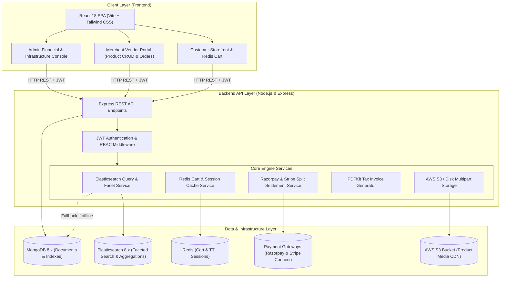
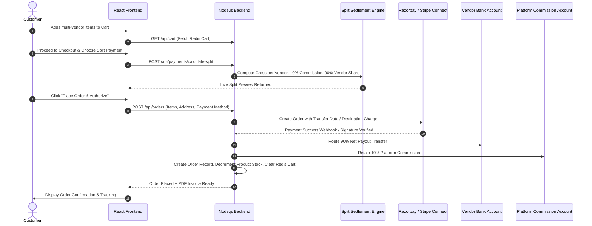
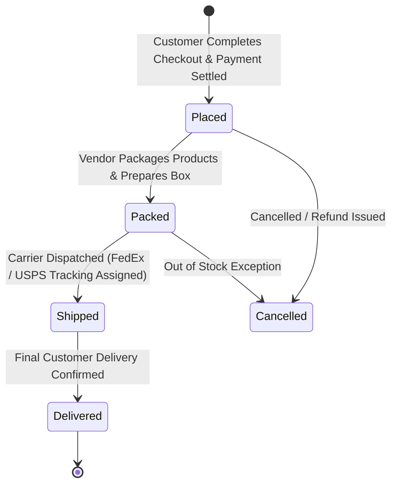
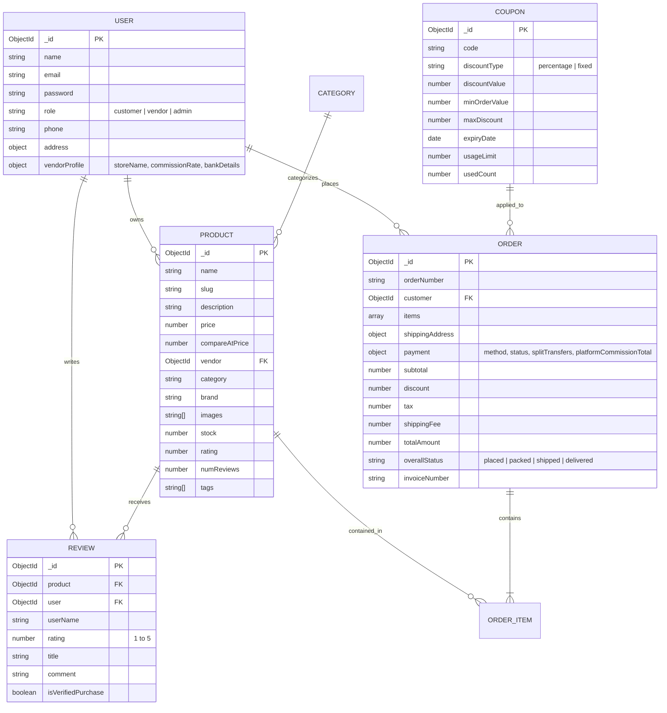

# OmniMarket - Multi-Vendor E-Commerce Platform Architecture

## 1. High-Level System Architecture

---

## 2. Multi-Vendor Split Payment Sequence Diagram

---

## 3. Order Lifecycle State Machine

---

## 4. Database Schema (Entity Relationship Diagram)

---

## 5. Architectural Highlights & Engineering Decisions

1. **Redis Caching for Carts & Sessions**:
   - Customer carts are stored with high-speed key-value access (`cart:user:{id}` and `cart:session:{id}`) with automatic TTL expiry (7 days).
   - Price rehydration ensures real-time inventory validation at moment of checkout without race conditions.

2. **Elasticsearch Indexing & Resilient Fallback**:
   - Products are indexed with custom edge n-gram tokenizers to provide substring search, typo-tolerant fuzzy matching, and multi-field boost (`name^3`, `brand^2`, `tags^2`).
   - If Elasticsearch is offline or unreachable in isolated environments, the system seamlessly transitions to MongoDB compound text & regex queries without throwing 500 errors.

3. **Multi-Vendor Split Settlement**:
   - Each order item carries individual vendor attribution, allowing independent fulfillment tracking.
   - Payout engine automatically allocates proportioned coupon discounts and calculates the exact 90/10 split before routing funds.

4. **Dynamic PDF Invoicing**:
   - Streaming PDF generation with PDFKit produces formatted tax invoices featuring itemized vendor breakdowns, shipping details, and barcode order numbering.

